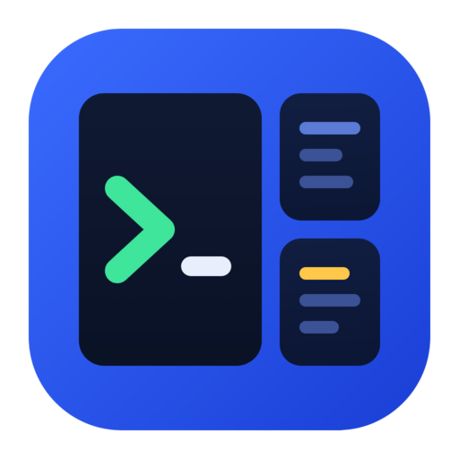
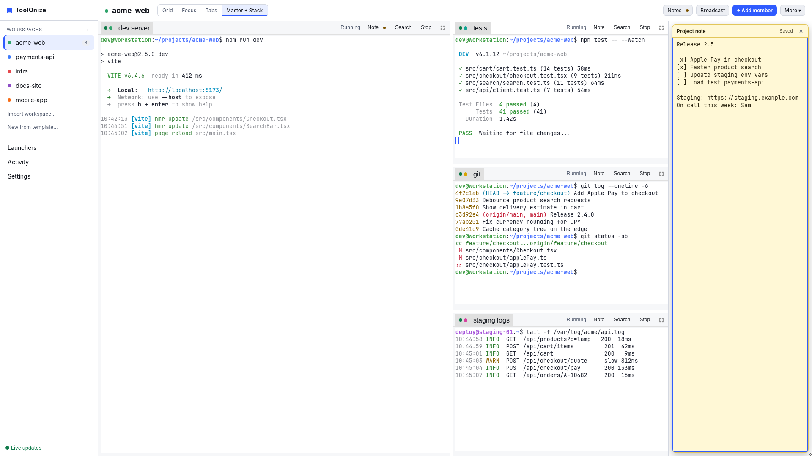

<p align="center">
  
</p>

<h1 align="center">ToolOnize</h1>

<p align="center">
  <b>Your dev tools. One persistent workspace.</b><br>
  Terminals, SSH sessions and apps for every project, in one window that comes back exactly as you left it.
</p>

<p align="center">
  <a href="../../releases/latest"></a>
</p>

<p align="center">
  
  
  
  
</p>

<p align="center">A <a href="https://crmonize.com"><b>CRMonize.com</b></a> product</p>

<p align="center">
  
</p>

## Why ToolOnize

Every project needs the same handful of terminals: the dev server, the tests, git, a shell on the staging box. ToolOnize keeps them together per project, so you switch projects in one click. They survive a reboot, a crash or a power cut. And it finds the tools you already have without ever running anything on its own.

## Features

- **A workspace per project.** Group terminals, SSH sessions and apps, and arrange them as Grid, Focus, Tabs or Master + Stack. Moving or maximizing a pane never restarts its terminal.
- **Comes back exactly as you left it.** After closing the app or losing power, ToolOnize reopens the same window with the same terminals, in the same folders, showing their last output. Commands with side effects are never re-run on their own.
- **Real terminals.** bash, zsh, fish, PowerShell, cmd, WSL distributions, your own `ssh`, and tmux. Output is lossless, even under heavy load.
- **SSH that just works.** Pick hosts from your `~/.ssh/config`, reconnect automatically when the connection drops, and copy and paste like a local terminal, including from tmux or vim on the server (OSC 52).
- **Sticky notes.** One note per terminal and one per project, saved instantly and safe across crashes.
- **Finds your tools, runs nothing on its own.** ToolOnize lists the launchers already on your system (application entries, Desktop, Start Menu), explains what each one would run, and asks you to review anything unusual. A launcher whose command changes needs your review again.
- **Find anything.** Search one terminal or all of them at once, Ctrl+click links, and save any terminal's output to a file.
- **Power tools.** Split in the same folder, zoom per terminal, broadcast typing, snippets, per-terminal environment variables and startup commands, full backup and restore, workspace templates, and a command palette for everything.
- **Updates itself, safely.** New versions install with one click. Every update is signed, and ToolOnize refuses anything that doesn't match its key.
- **Private by design.** No account, no cloud, no telemetry. Your data stays on your computer.
- **English and Arabic,** with a full right-to-left interface.

## Install

Download the file for your system from the [latest release](../../releases/latest):

| System | File | Install |
|---|---|---|
| Ubuntu, Debian, Linux Mint | `.deb` | `sudo apt install ./ToolOnize_*_amd64.deb` |
| Fedora, openSUSE | `.rpm` | `sudo dnf install ./ToolOnize-*.rpm` (openSUSE: `sudo zypper install ./ToolOnize-*.rpm`) |
| Other Linux | `.AppImage` | `chmod +x ToolOnize_*.AppImage`, then run it (needs FUSE 2, e.g. `libfuse2`) |
| Windows 10 / 11 | `_x64-setup.exe` | Run the installer. Windows may show a SmartScreen warning because the installer is not code-signed. |

- **Updates come to you.** ToolOnize checks for new releases and installs them with one click (Settings › Updates).
- **Upgrading by hand** works the same way as installing; your workspaces, notes and settings are kept.
- **Check a download** with `SHA256SUMS.txt` from the same release (`sha256sum -c SHA256SUMS.txt --ignore-missing`) or with the `gh attestation verify` command in the release notes.
- **Uninstall** with `sudo apt remove tool-onize` (deb) or `sudo dnf remove tool-onize` (rpm), delete the AppImage, or use *Installed apps* on Windows. Your data stays in the folders listed under [Build from source](#build-from-source) until you delete them.

## Keyboard shortcuts

| Action | Shortcut |
|---|---|
| Command palette | `Ctrl+Shift+P` |
| New terminal | `Ctrl+Shift+T` |
| Split right / down | `Ctrl+Shift+E` / `Ctrl+Shift+O` |
| Search this terminal / all terminals | `Ctrl+Shift+F` / `Ctrl+Shift+G` |
| Terminal note / project note | `Ctrl+Shift+N` / `Ctrl+Shift+M` |
| Copy / paste | `Ctrl+Shift+C` / `Ctrl+Shift+V` |
| Rename terminal | `Ctrl+Shift+R` or `F2` |
| Layouts: Grid, Focus, Tabs, Master + Stack | `Ctrl+Shift+1` … `Ctrl+Shift+4` |
| Settings | `Ctrl+,` |

Every shortcut can be changed in Settings.

## Security and privacy

- The interface is untrusted by design: it cannot start a program by itself. Everything that runs goes through an execution policy in the Rust core, bound to the exact command you approved.
- ToolOnize stores no passwords or keys; SSH uses your own `ssh`, agent and config.
- Saved terminal output stays in a folder only you can read and never leaves your computer.

Found a vulnerability? Please report it privately, as described in [SECURITY.md](SECURITY.md). The full analysis is in the [threat model](docs/security/THREAT_MODEL.md).

## Build from source

One command checks everything ToolOnize needs, shows a single plan, asks for your consent and administrator password **once**, then installs it all:

```bash
./setup.sh              # Linux (and the macOS toolchain)
./setup.sh --check      # report only, change nothing
```

On Windows: `powershell -ExecutionPolicy Bypass -File scripts\setup\windows.ps1`. Details: [`docs/setup/SETUP.md`](docs/setup/SETUP.md).

```bash
npm ci
npm run tauri -- dev      # development window with hot reload
npm run tauri -- build    # installers: deb, rpm, AppImage (Linux) / NSIS (Windows)
```

Tests and checks:

```bash
npm test && npm run lint && npm run typecheck
cd src-tauri && cargo test && cargo clippy --all-targets -- -D warnings
```

ToolOnize keeps its state in `$XDG_STATE_HOME/toolonize` and settings in `$XDG_CONFIG_HOME/toolonize` on Linux, or `%APPDATA%\toolonize` on Windows (`TOOLONIZE_STATE_DIR` and `TOOLONIZE_CONFIG_DIR` override them). Deleting those folders removes everything ToolOnize stored.

## How it works

A Rust core (Tauri 2) does all privileged work: launcher discovery and classification, the execution policy, terminal sessions (portable-pty) and persistence. The React and TypeScript interface is treated as untrusted. It can only call a fixed set of typed commands, none of which accepts a program, arguments or a command line. Each terminal has one long-lived xterm.js view that layout changes only move, so a terminal never restarts because you rearranged the window.

## Documentation

| Document | What it covers |
|---|---|
| [Architecture](docs/architecture/ARCHITECTURE.md) | Components, data flows and where each part lives in the code |
| [Decision records](docs/adr/README.md) | Why each significant technical choice was made |
| [Threat model](docs/security/THREAT_MODEL.md) | Threats, mitigations and the code that implements them |
| [Platform adapters](docs/architecture/PLATFORM_ADAPTERS.md) | How Linux and Windows differences are handled |
| [Domain model](docs/architecture/DOMAIN_MODEL.md) | Workspaces, members, launchers and session states |
| [Setup](docs/setup/SETUP.md) | Preparing a development machine |
| [Updates](docs/release/UPDATES.md) and [releases](docs/release/RELEASE_CHECKLIST.md) | How signed updates and releases work |
| [Dependencies](docs/security/DEPENDENCIES.md) | Every dependency, its license and why it is used |

## Contributing

Bug reports, ideas, translations and pull requests are welcome. Start with [CONTRIBUTING.md](CONTRIBUTING.md); everyone taking part follows the [code of conduct](CODE_OF_CONDUCT.md).

## About CRMonize.com

ToolOnize is developed and maintained by [CRMonize.com](https://crmonize.com) and released as free, open-source software. Visit [crmonize.com](https://crmonize.com) to learn more about the company and its other products.

## License

Licensed under either of the [MIT License](LICENSE-MIT) or the [Apache License 2.0](LICENSE-APACHE), at your option.

Copyright © CRMonize.com and the ToolOnize contributors.
