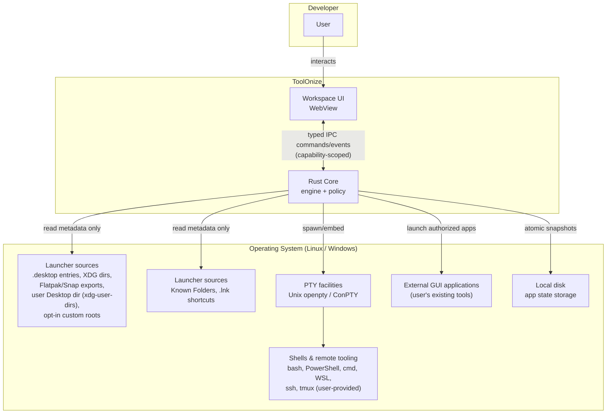
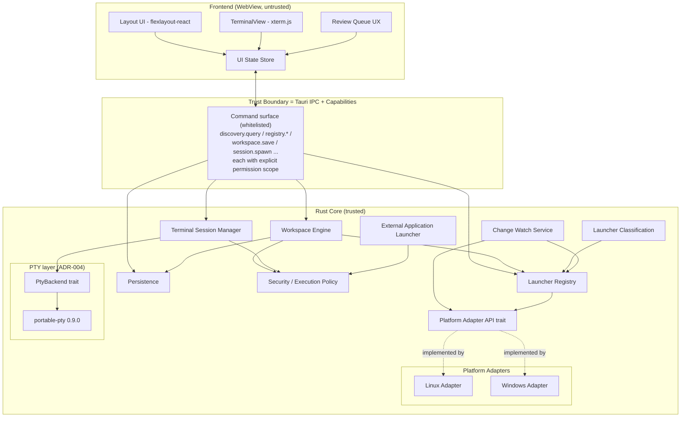
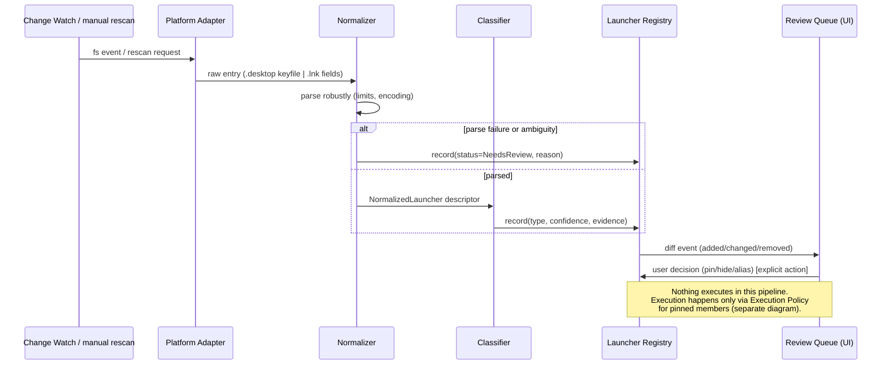
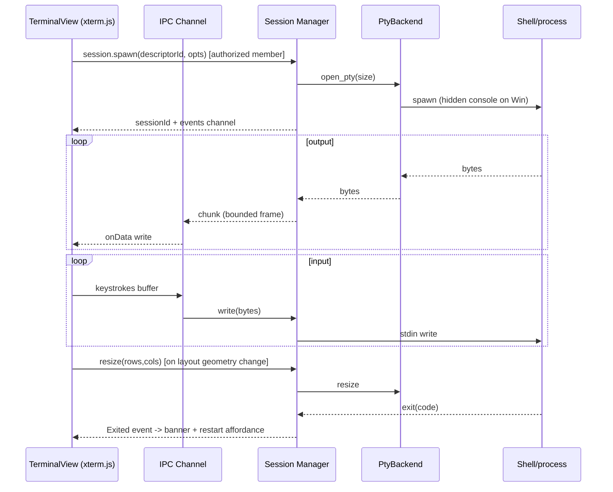

# Architecture

This document describes how ToolOnize is built; §15 maps each component to
its code.

Companion documents: [DOMAIN_MODEL.md](DOMAIN_MODEL.md) (entities),
[PLATFORM_ADAPTERS.md](PLATFORM_ADAPTERS.md) (OS boundaries),
[THREAT_MODEL.md](../security/THREAT_MODEL.md) (security analysis), and the
[decision records](../adr/README.md) (why each choice was made).

---

## 1. Architectural style

Single cross-platform desktop application:

- **Rust core** (Tauri 2 backend): owns all privileged capability — discovery,
  registry, classification, execution policy, PTY sessions, persistence.
- **React/TypeScript frontend**: workspace UI, docking layout, terminal
  rendering. Treated as untrusted by design.
- **Trust boundary**: the Tauri IPC bridge with a capabilities/permissions
  model; the frontend may only invoke explicitly whitelisted, scoped commands
  (ADR-001; v2.tauri.app/security).

## 2. Context diagram

Notes:
- Discovery touches launcher sources read-only; execution is a separate,
  authorized path.
- ssh/tmux are the *user's own* environment; we embed terminals that use
  them, we do not implement SSH or multiplexing.

## 3. Container/component diagram

Every frontend→core arrow crosses exactly one boundary (IPC command with
scope). There is deliberately no "generic exec" command — see THREAT_MODEL
T-WEB-01.

## 4. Component responsibilities

| Component | Owns | Must not |
| --- | --- | --- |
| Launcher Registry | normalized records, launcher_id + descriptor_fingerprint, user decisions (pin/hide/alias), diffing | execute anything; use ID mutation as a security mechanism |
| Launcher Classification | deterministic rules → type + confidence + reasons | mutate registry |
| Change Watch | fs events → rescan/diff triggers | touch sessions |
| Workspace Engine | workspaces, membership, startup policy orchestration | bypass policy |
| Terminal Session Manager | process session state machine, PTY handles, lossless output pump, restart/reconnect semantics | trust frontend sizes blindly; drop PTY bytes |
| Security/Execution Policy | argv construction, authorization checks bound to launcher_id+descriptor_fingerprint+scope, audit log | delegate decisions to frontend |
| External App Launcher | detached launch of authorized external targets | manage foreign windows |
| Persistence | atomic checksummed snapshots, migrations, import/export validation | store secrets |
| Platform Adapter API | traits: LauncherSource, FsWatch, ShellResolver | contain business logic |
| Linux/Windows Adapter | concrete source enumeration + watchers per research docs | leak platform details upward |
| Layout UI | FlexLayout model, mode transforms, drag/dock — mutates view attachment/layout only | own session lifetime or mutate process state |
| TerminalView | xterm instance, addons, input/output wiring to session bus | spawn processes |

## 5. Launcher discovery pipeline

Design rules: Linux Exec parsing follows the Desktop Entry spec's quoting and
field-code rules — never shell interpretation; Windows `.lnk` files are read
from their stored metadata and `IShellLink::Resolve` is never called
(ADR-007), so discovery never silently re-targets or mutates links.

## 6. Terminal PTY data flow

Lifecycle independence rules (ADR-003):

1. **Process vs view separation.** The *session* lives in Rust keyed by
   sessionId and carries `process_state` (New/Starting/Running/Exited/Failed/
   Stopping/Closed; remote adds Disconnected/Reconnecting). The view carries
   a separate `view_state` (Detached/Attached/Hidden). Layout moves re-parent
   the DOM node and mutate only `view_state`; they never close, reset, or
   respawn a session.
2. **Guaranteed by tests** — FlexLayout's own "preservation of component
   state when tabs are moved" covers React state only, so ToolOnize tests its
   terminal lifecycle directly:
   - xterm `Terminal` instance identity remains stable across drag, tabset
     move, maximize, restore, tab switch, and all four mode transformations;
   - PTY session id remains stable;
   - `dispose()` is never called on layout movement;
   - scrollback remains intact for ordinary layout changes;
   - resize propagation (rows/cols) remains correct through every transform;
   - Focus → Restore returns the exact running terminal (same instance,
     same session, same scrollback);
   - mode transformations do not respawn processes.
3. **Stable-host architecture.** One long-lived terminal host
   (`TerminalController`) per session owns the xterm.js instance; layout
   nodes only attach its element, and park it off-screen when they unmount.
4. Scrollback lives in the xterm buffer while its view exists; if a view is
   destroyed (member removed), scrollback up to the cap is retained
   server-side only if the member is kept in the workspace — otherwise
   discarded with the session closed explicitly.

Output delivery requirement: the output path is **lossless**. Terminal VT
streams are stateful — silently dropping arbitrary bytes can corrupt escape
sequences and renderer state. The pump uses bounded batching/coalescing with
high/low water marks and backpressure toward the PTY reader/child via normal
OS flow-control consequences; per-session isolation prevents one stream from
blocking others; exceeding a hard safety limit surfaces an explicit
desynchronization/error state — never silent byte loss. Chunk sizes and
queue limits come from measurements on Linux and Windows (ADR-004).

## 7. Layout ownership and modes

FlexLayout Model is owned by the frontend store; it is *projection*, not
truth. Truth = Workspace Engine membership list + saved layout JSON snapshot.
Mode transforms (Grid/Focus/Tabs/Master+Stack) are pure functions over the
layout JSON producing new valid models; sessions untouched. On save,
`model.toJson()` is validated against our schema then persisted via
workspace.save. Import treats external JSON as hostile (schema-limited,
size-capped).

## 8. Workspace persistence flow

Save: the core serializes {schemaVersion, workspaces[{members[], layoutJson,
policy, meta}], registryDecisions} → validate → checksummed snapshot written
to a temp file → atomic rename → fsync dir; the previous generations are kept
(ADR-006). Load: verify checksum and schema → migrate if needed → hand to the
core; a corrupt newest generation ⇒ previous generation + user-visible
loss-window report.

Session honesty: persisted state stores *membership and descriptors*, never
processes. On restore, terminal members start fresh unless policy says ask/
start; tmux-based members display reconnect affordance because their real
state lives in tmux, not here.

## 9. Process/session lifecycle states

Two orthogonal state machines (details and invariants: DOMAIN_MODEL §3):

- **ProcessSessionState** (PTY/child-process or remote attach):
  `New → Starting → Running → Exited(code) | Failed(reason)`, plus
  `Stopping → Closed` on close, a `Restarting` transition, and — remote
  members only — `Disconnected ↔ Reconnecting` (user-initiated). Plain SSH
  reconnect starts a NEW remote shell/process unless the invoked remote
  environment itself persists state; tmux/screen persistence belongs to the
  external multiplexer. The Rust-owned local PTY process can survive a
  renderer/WebView reload while the native application stays alive; whole-app
  exit terminates local children per policy; "detach expected" members are
  documented as externally persistent.
- **ViewAttachmentState** (`Detached | Attached | Hidden`): owned by the
  layout layer. Drag, tab switch, focus, grid, maximize, restore and any
  workspace layout transformation mutate ONLY this machine and layout JSON.

Underlying script changes never signal sessions; they only update
registry descriptors used at next explicit start.

## 10. Failure containment

- One panicking adapter scan → that source marked degraded; others continue.
- Session pump isolation: a misbehaving PTY stream cannot block IPC of other
  sessions (per-session bounded queues; lossless delivery with batching,
  water marks, and backpressure — see §6 output requirement; a hard-limit
  breach surfaces an explicit desynchronization/error state, never silent
  byte loss).
- Renderer crash: Rust core persists nothing mid-command (commands are
  transactional), sessions keep running; reload reattaches by sessionId.
- Watch overflow (inotify queue / ReadDirectoryChangesW buffer) → full rescan
  fallback, UI badge.
- Persistence failure (disk full) → command returns error; the previous
  snapshot stays intact.

## 11. Platform adapter boundaries

See PLATFORM_ADAPTERS.md for full contracts. Summary: adapters expose three
traits — `LauncherSource` (enumerate raw launchers), `FsWatch` (change
events), `ShellResolver` (default shells/WSL lists/terminal-emulator hints).
All platform quirks (XDG vs Known Folders; inotify vs ReadDirectoryChangesW;
hidden-console spawn flags) live below this line.

## 12. Configuration storage boundary

App writes only under: Linux `$XDG_CONFIG_HOME/<app>` + `$XDG_STATE_HOME/<app>`
(or documented fallbacks); Windows `%APPDATA%\<app>` resolved via Known
Folder APIs. Contents: settings (config directory); state snapshot
generations, the audit log, the diagnostic log, and session memory in a
private `memory/` folder (state directory).
Never written: anything under the repository checkout at runtime; secrets
anywhere. Deleting these directories removes everything ToolOnize stored.

## 13. Dependencies

Each dependency choice is recorded in an ADR or in
[DEPENDENCIES.md](../security/DEPENDENCIES.md) with its license and reason.
PATH-wide scanning and any AI or cloud dependency are deliberately excluded.

## 14. Deliberately absent abstractions (anti-overengineering)

No plugin API, no scripting engine, no abstraction over "future cloud sync",
no generic "task runner" concept, no custom widget toolkit, no ORM — each
would add complexity without a user need today.

## 15. Implementation map

| Component (§4) | Code |
| --- | --- |
| IPC command surface | `src-tauri/src/commands/` — inventory `ALLOWED_COMMANDS`, checked against `build.rs` and `capabilities/default.json` by tests |
| Application core (transactions, events) | `src-tauri/src/app/` (`mod.rs`: `Core`, `mutate`, event bus) |
| Launcher Registry | `src-tauri/src/registry.rs` |
| Launcher Classification | `src-tauri/src/classify.rs` |
| Change Watch | `src-tauri/src/discovery/watch.rs` (`notify`: inotify / ReadDirectoryChangesW) |
| Platform adapters | `src-tauri/src/discovery/{linux,keyfile,exec,walk}.rs`, `discovery/{windows,lnk}.rs`, `shells.rs` |
| Workspace Engine | `src-tauri/src/workspace.rs` + `app/workspaces.rs` |
| Security / Execution Policy | `src-tauri/src/policy.rs`, audit in `audit.rs` |
| External App Launcher | `src-tauri/src/external.rs` |
| Terminal Session Manager | `src-tauri/src/session/{manager,output,state}.rs` |
| PTY layer | `src-tauri/src/pty/` (portable-pty 0.9.0 + mitigations, ADR-004) |
| Persistence | `src-tauri/src/persist.rs` (ADR-006), `transfer.rs` (import/export), `backup.rs` (ADR-014), `settings.rs` |
| Notes and session memory | `src-tauri/src/notes.rs` (ADR-012), `memory.rs` (ADR-015) |
| Updates and open at login | `src-tauri/src/updates.rs` (ADR-019), `autostart.rs` (ADR-017) |
| SSH hosts | `src-tauri/src/sshconfig.rs` (ADR-011) |
| Layout UI | `src/layout/` (FlexLayout, pure mode presets) |
| TerminalView | `src/terminal/` (long-lived controller per session; panes attach/park it) |
| Review Queue UX | `src/views/LaunchersScreen.tsx`, `src/lib/review.tsx` |
| UI State Store | `src/state/store.ts` (projection of core state, refreshed by core events) |
| Translations | `src/i18n/` (English keys, Arabic catalog, right-to-left layout; ADR-018) |

Output transport as built: the PTY reader appends to a per-session log with
absolute offsets; one pump thread sends `[u64 LE offset][bytes]` frames over
a Tauri Channel to the attached view; the view acknowledges after xterm.js
finished writing. The reader pauses at the high-water mark of unacknowledged
bytes (2 MiB, resumes at 1 MiB); a view that stops acknowledging for 20 s
while the reader is paused is detached with an explicit desync event. With no
view attached, a bounded replay window (default 4 MiB, configurable) is kept
so a reloaded renderer can redraw; a reattach that falls outside it is told
`trimmed` and resets the screen with a visible notice.
